# Jotty Android

<p align="center">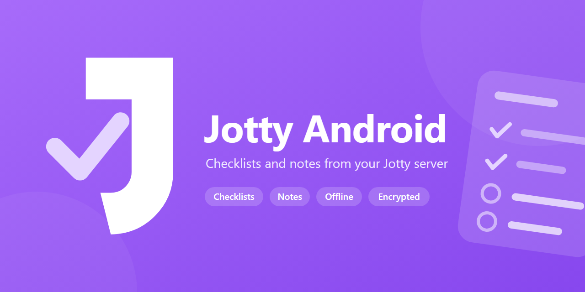</p>


[](https://github.com/Darknetzz/jotty-android/releases/latest)
[](https://github.com/Darknetzz/jotty-android/releases/tag/dev-latest)

An unofficial Android client for [Jotty](https://jotty.page/) — the self-hosted, file-based checklist and notes app.

> This is an independent community project and is not an official Jotty app, and is not affiliated with or endorsed by the Jotty project.

**Disclaimer:** This project is built mostly for personal use. Much of the code was written with AI assistance and may contain bugs or rough edges. If you find issues or want to improve things, issues and contributions are welcome. The web version of Jotty is very much mobile friendly and is probably sufficient for most people.

## Features

- **Checklists** — Task lists with progress, inline edit, reorder (buttons or optional drag), and bulk **Check all / Uncheck all / Clear all** per section. **Project / Kanban** boards support column status management, task moves and item fields.
- **Notes** — Markdown notes with search, category filters, GFM tables and server-hosted images. Markdown editor with toolbar and list continuation, or an optional rich (WYSIWYG) editor. Drafts are autosaved; new notes from server templates.
- **Organise and share** — Change category, archive, clone, sort items, and share via Jotty's share links (Jotty 1.29+) or as text.
- **Offline** — Notes and checklists work without a connection, including when your server is only reachable at home. Changes sync on reconnect; a pending-sync manager shows what is waiting and lets you resolve it.
- **Multi-instance** — Save several Jotty servers, set a default, assign an accent colour, and add custom HTTP headers (e.g. for reverse-proxy auth).
- **Encryption** — XChaCha20-Poly1305 encrypt and decrypt in-app; optional biometric unlock for remembered passphrases (PGP-encrypted notes require the [Jotty web app](https://jotty.page/)).
- **Quick capture** — Home-screen widget for a new note, and "Share to Jotty" from other apps.
- **Appearance** — System/light/dark theme, colour palettes, custom accent hex, reader text size, and content padding.
- **Languages** — English and Norwegian Bokmål; follows the phone's language or pick one in Settings.
- **Settings & dashboard** — Health check, behaviour toggles, server summary, security controls, exportable debug logs, and in-app update check (stable or dev channel).
- **Deep links** — `jotty-android://open/note/{id}` opens a note directly in the app.
- **Connect** — Works with self-hosted Jotty **1.25.0 or newer** via server URL and API key.

## Screenshots

Demo content from v1.5.0, so some screens have changed since. **Dark** is left, **light** is right. All captures in [`images/`](images/) (`readme-*.png`).

<table>
  <thead>
    <tr>
      <th align="center" width="50%">Dark</th>
      <th align="center" width="50%">Light</th>
    </tr>
  </thead>
  <tbody>
    <tr>
      <td align="center">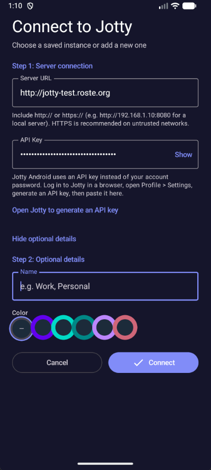</td>
      <td align="center">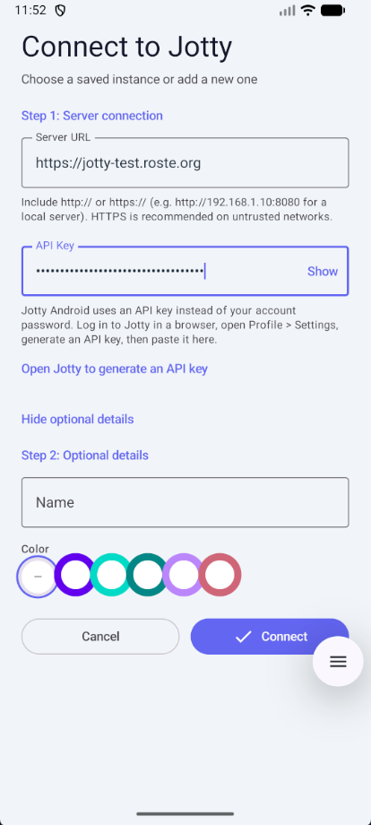</td>
    </tr>
    <tr>
      <td colspan="2" align="center"><sub><b>Connect</b> — server URL, API key, and accent color</sub></td>
    </tr>
    <tr>
      <td align="center">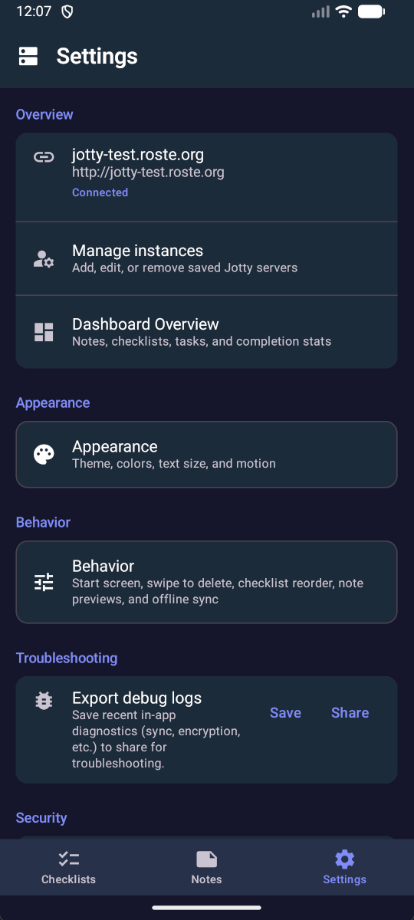</td>
      <td align="center">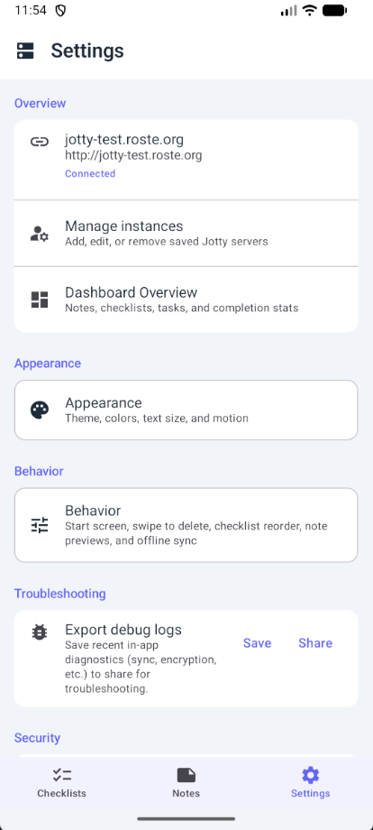</td>
    </tr>
    <tr>
      <td colspan="2" align="center"><sub><b>Settings</b> — instance, appearance, behavior, troubleshooting</sub></td>
    </tr>
    <tr>
      <td align="center">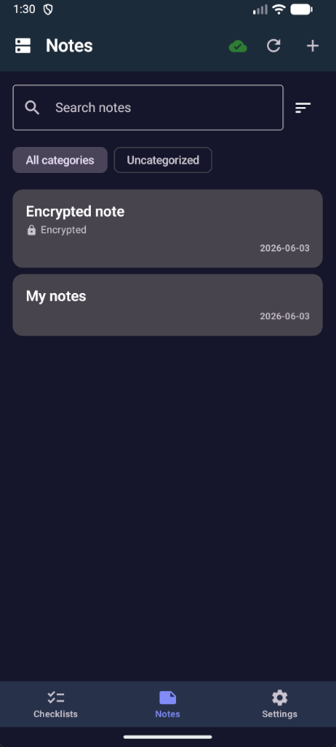</td>
      <td align="center">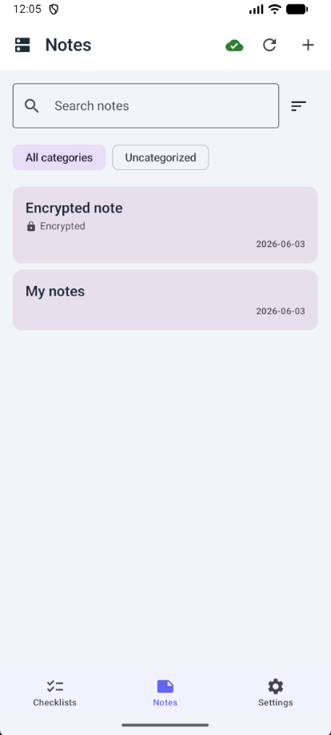</td>
    </tr>
    <tr>
      <td colspan="2" align="center"><sub><b>Notes list</b> — search and encrypted note badge</sub></td>
    </tr>
    <tr>
      <td align="center">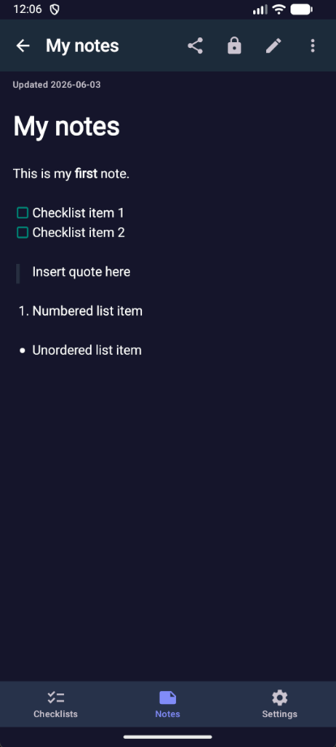</td>
      <td align="center">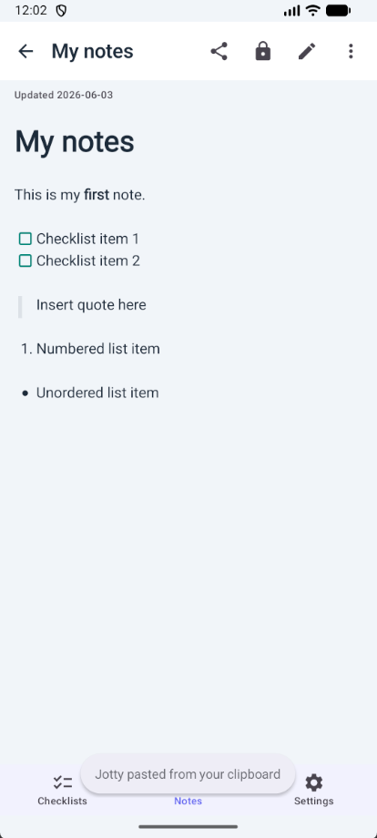</td>
    </tr>
    <tr>
      <td colspan="2" align="center"><sub><b>Note detail</b> — Markdown, lists, quotes, checkboxes</sub></td>
    </tr>
    <tr>
      <td align="center">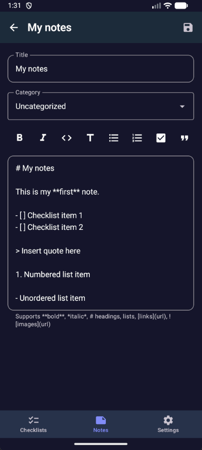</td>
      <td align="center">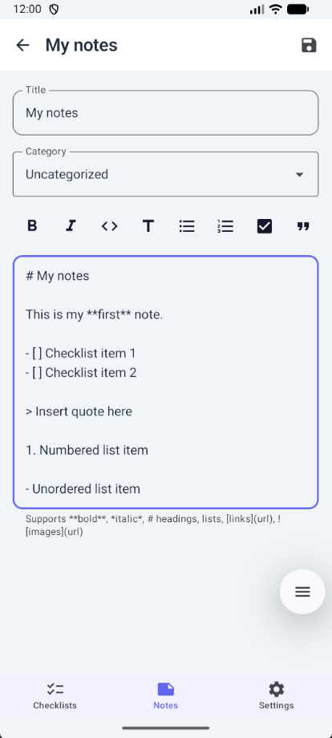</td>
    </tr>
    <tr>
      <td colspan="2" align="center"><sub><b>Note editor</b> — formatting toolbar</sub></td>
    </tr>
    <tr>
      <td align="center">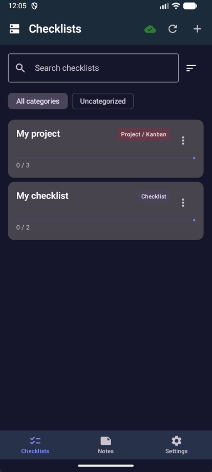</td>
      <td align="center">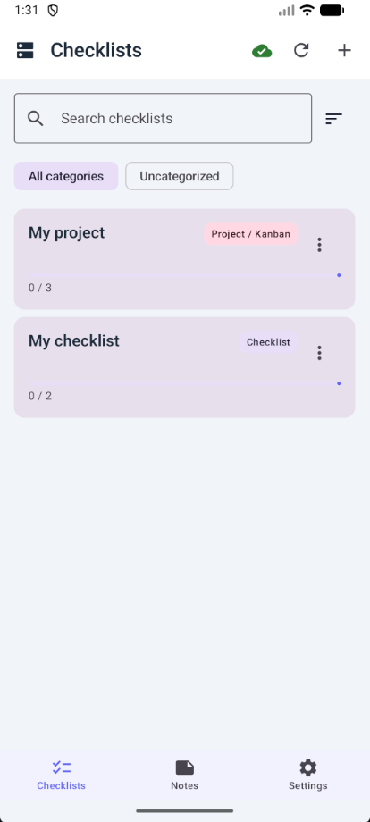</td>
    </tr>
    <tr>
      <td colspan="2" align="center"><sub><b>Checklists</b> — lists and Kanban projects with progress</sub></td>
    </tr>
    <tr>
      <td align="center">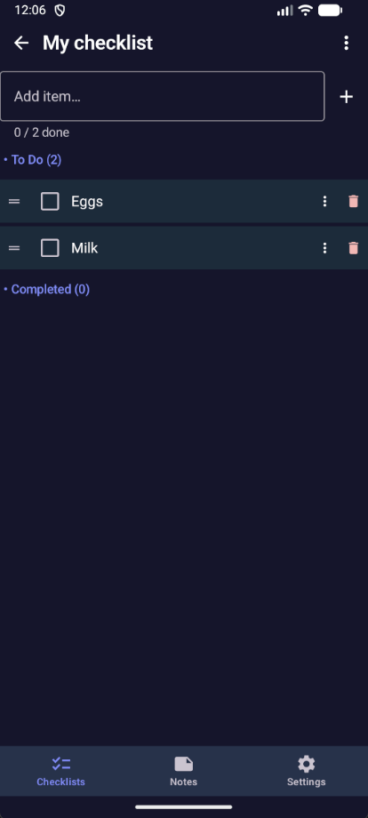</td>
      <td align="center">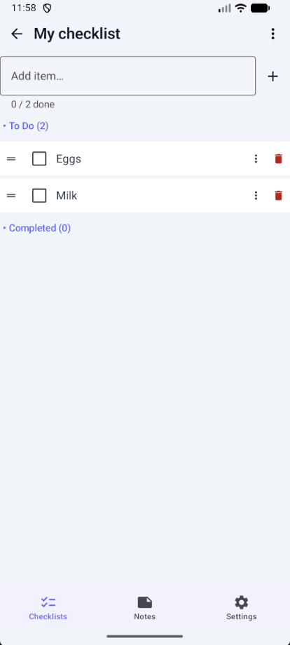</td>
    </tr>
    <tr>
      <td colspan="2" align="center"><sub><b>Checklist detail</b> — items, reorder, progress</sub></td>
    </tr>
    <tr>
      <td align="center">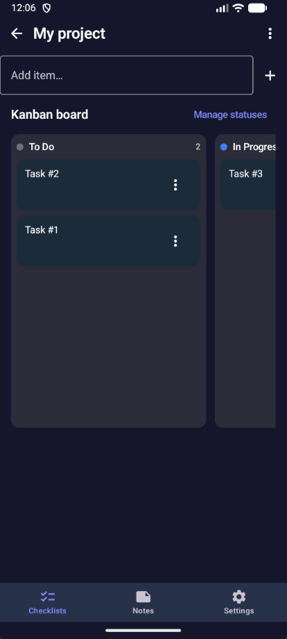</td>
      <td align="center">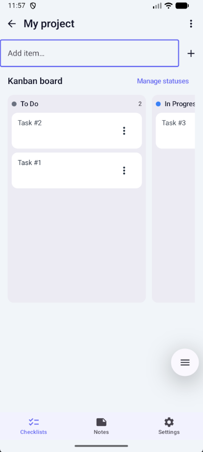</td>
    </tr>
    <tr>
      <td colspan="2" align="center"><sub><b>Kanban</b> — columns, tasks, manage statuses</sub></td>
    </tr>
    <tr>
      <td align="center">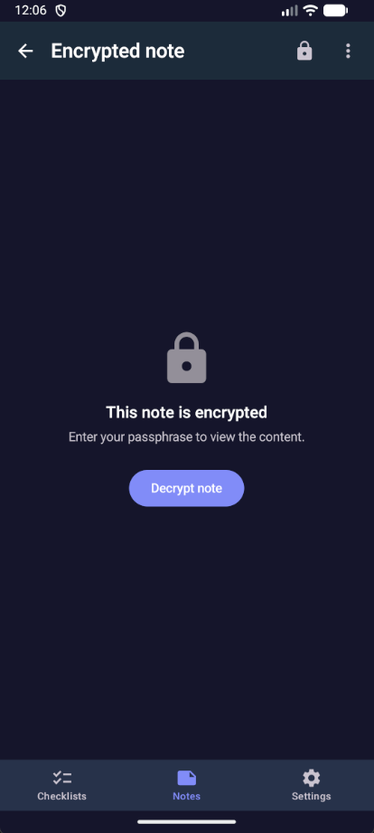</td>
      <td align="center">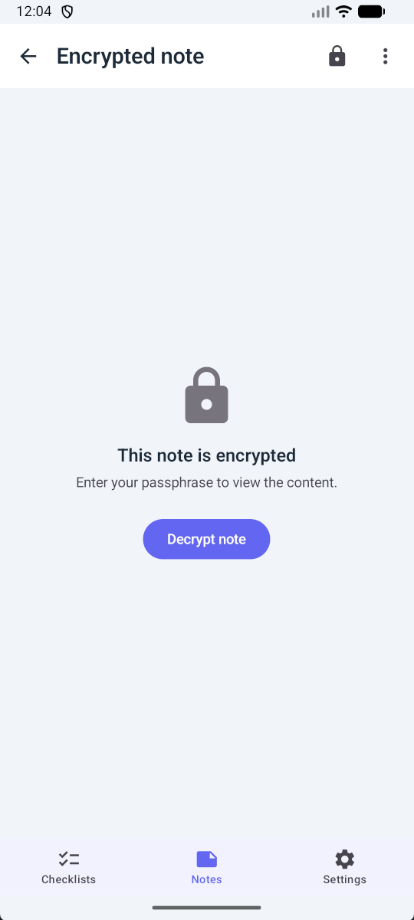</td>
    </tr>
    <tr>
      <td colspan="2" align="center"><sub><b>Encrypted note</b> — locked until you decrypt</sub></td>
    </tr>
    <tr>
      <td align="center">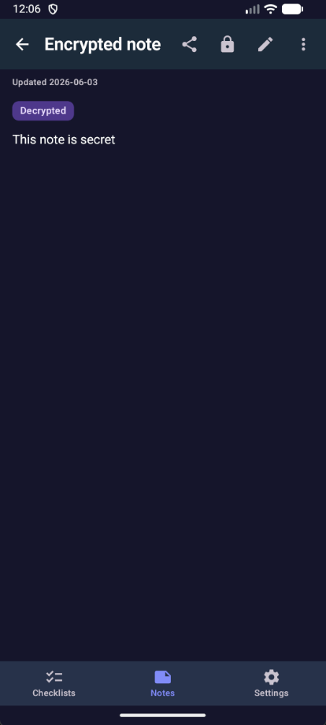</td>
      <td align="center">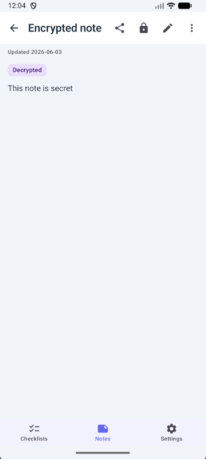</td>
    </tr>
    <tr>
      <td colspan="2" align="center"><sub><b>Encrypted note</b> — decrypted with session badge</sub></td>
    </tr>
    <tr>
      <td align="center">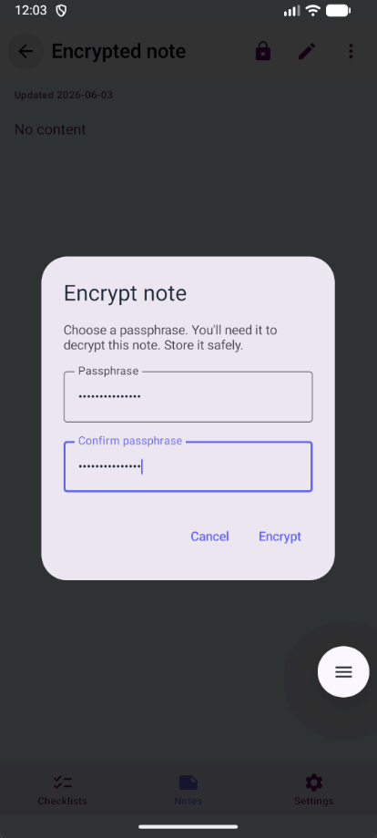</td>
      <td align="center">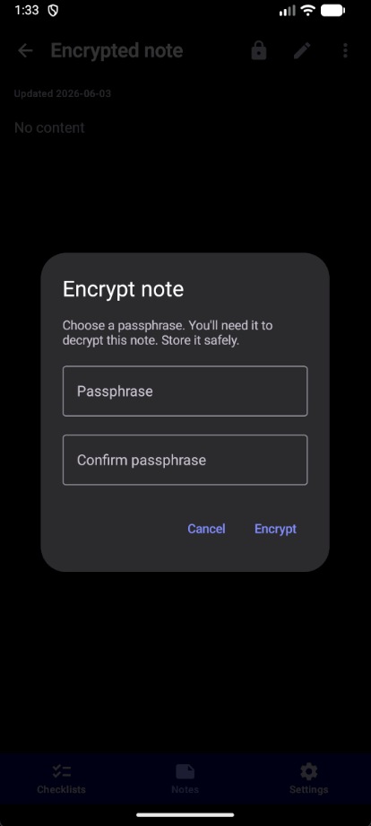</td>
    </tr>
    <tr>
      <td colspan="2" align="center"><sub><b>Encrypt</b> — passphrase dialog</sub></td>
    </tr>
    <tr>
      <td align="center">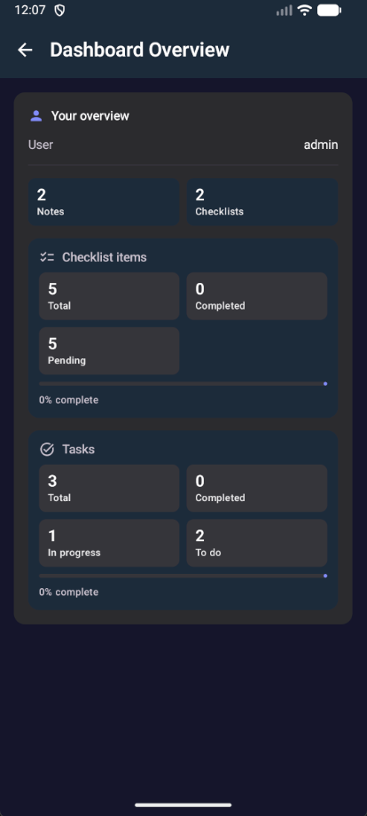</td>
      <td align="center">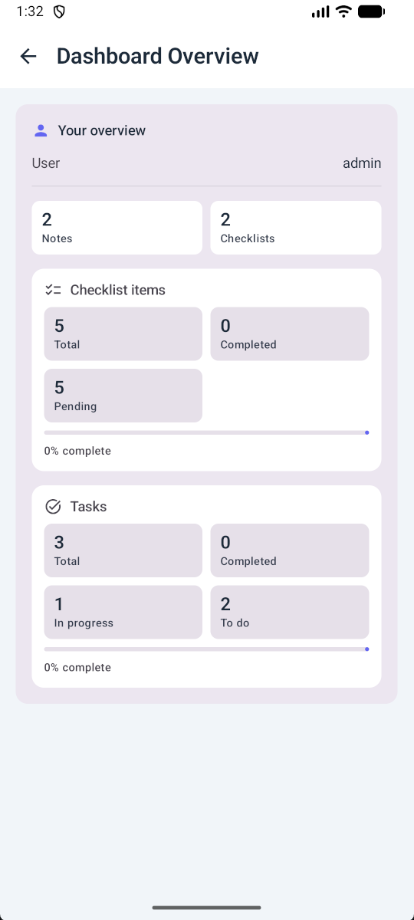</td>
    </tr>
    <tr>
      <td colspan="2" align="center"><sub><b>Dashboard</b> — server stats overview</sub></td>
    </tr>
  </tbody>
</table>

## Releases / Download

Download the APK from [Releases](https://github.com/Darknetzz/jotty-android/releases):

- **Stable:** `jotty-android-X.Y.Z.apk` from the [latest release](https://github.com/Darknetzz/jotty-android/releases/latest).
- **Dev:** the rolling [dev-latest](https://github.com/Darknetzz/jotty-android/releases/tag/dev-latest) pre-release, rebuilt from every commit on `dev`.

Both are signed with the same release key, so either installs over the other as long as the version code goes up. Moving from a dev build back to stable needs an uninstall (see Troubleshooting). Enable "Install unknown apps" for your browser or file manager if Android asks.

The app can check for updates itself: Settings → About → **Check for updates**.

## Setup

### 1. Get your API key

1. Log into your Jotty instance in a browser.
2. Go to **Profile** → **Settings**.
3. In the **API Key** section, click **Generate**.
4. Copy the generated key (starts with `ck_`).

### 2. Configure the app

1. Open the app.
2. Enter your Jotty server URL (e.g. `https://jotty.example.com`).
3. Enter your API key.
4. Tap **Connect**.

## Releasing

Maintainers: the version lives in `gradle.properties` (`VERSION_NAME`, `VERSION_CODE`); user-visible changes go under `[dev-latest]` in `CHANGELOG.md`.

- **Dev builds:** `git push origin dev` (GitLab). GitLab CI runs the tests and publishes [dev-latest](https://github.com/Darknetzz/jotty-android/releases/tag/dev-latest).
- **Stable release:** `.\release.ps1` (or `./release.sh`) bumps the version and promotes the changelog; commit it on `dev`, then run `.\scripts\publish-release.ps1` (or `.sh`). That merges `dev` into `main`, tags `vX.Y.Z`, and GitLab CI builds the APK and creates the GitHub release.

GitLab is the source of truth and GitHub is a push mirror. Setup, CI variables, the moving `dev-latest` tag, local fallbacks (`-LocalBuild`) and signing are covered in [docs/LOCAL_CI.md](docs/LOCAL_CI.md); run `scripts/setup-repo-git.ps1` (or `.sh`) once per clone.

## Building

### Requirements

- JDK 17+ and Android SDK 36 (min SDK 26, Android 8.0), or a current Android Studio
- Jotty server **1.25.0** or newer (older servers are refused when connecting)

The Gradle wrapper is checked in, so no separate Gradle install is needed.

### Build commands

```bash
# Debug APK
./gradlew assembleDebug

# Release APK (signed when keystore.properties exists; see keystore.properties.example)
./gradlew assembleRelease

# What CI runs: unit tests, lint, ktlint
./scripts/ci-local.sh        # Windows: .\scripts\ci-local.ps1
```

On Windows, `build.ps1` wraps the wrapper and checks for Java.

## Troubleshooting

### “App not installed” when updating

Android only allows an update when the new APK is signed with the **same certificate** as the installed app. This happens if you switch between a **debug** build, a **locally built** APK, and a **GitHub release** APK, or if releases were signed with different keys.

- **Fix for users:** Uninstall the old app once, then install the APK from the latest [Release](https://github.com/Darknetzz/jotty-android/releases). Uninstall clears **app data on the device** (saved server instances, API keys, offline cache)—you will need to add your instance again. Content on your **Jotty server** is not deleted.
- **Fix for maintainers:** Use one release keystore for every GitHub release (secrets in `keystore.properties.example`). Do not change the keystore between releases.

### Server log: `Session check error` / `ERR_SSL_WRONG_VERSION_NUMBER`

This usually means something is speaking **HTTP** where **TLS (HTTPS)** is expected:

- **If the app talks to your server:** In the app, use an instance URL that starts with `https://` (e.g. `https://jotty.example.com`). If you enter a URL without a scheme, the app adds `https://` by default.
- **If the server does a “session check”** (e.g. an outbound request to validate the session): that request’s URL must use `https://`. Check the Jotty server config (e.g. app URL, callback URL, or any URL used for session validation) and ensure it’s HTTPS, not HTTP.

### Encrypted note from an old app version won't open on the web

Early versions of the app wrote encrypted notes with a different field order that the Jotty web app cannot read. The app still decrypts them and shows a warning: open the note, decrypt it, and use **Re-encrypt for web** to save it in the current format.

## Architecture

- **Jetpack Compose** — UI
- **Retrofit** — REST API client for Jotty
- **Room** — Local database for offline storage
- **DataStore** — Storing app settings and instance metadata
- **EncryptedSharedPreferences** — Secure API key storage (with DataStore fallback when unavailable)
- **Navigation Compose** — Screen navigation

## Offline Support

With **Settings → Behavior → Local storage & sync** on (the default), notes and checklists are stored on the device and synced when the server can be reached. The app also counts as offline when the phone has a network but your server does not answer (for example a home-only address while you are out).

- Create, edit and delete notes and checklist items without a connection; changes sync in the order you made them.
- Sync status icon, per-item **Pending sync** labels, and a pending-sync manager to compare and resolve unsent changes.
- Background sync every few hours.
- Conflicts never lose data: the server version is kept and your version is saved as a separate "(Local copy)" until you compare the two and keep one, both, or a merged note.

Details: [docs/OFFLINE_SYNC.md](docs/OFFLINE_SYNC.md).

## Encryption

Jotty supports **XChaCha20-Poly1305** (passphrase-only, recommended) and **PGP**. This app supports only **XChaCha20-Poly1305** in-app: you can encrypt and decrypt notes with a passphrase. Notes encrypted with **PGP** in the Jotty web app must be decrypted there; the app will show a short message and a link to use the web app.

**Limitations:** Encrypted note content cannot be searched (titles and metadata remain searchable). Only the key owner can decrypt; shared encrypted notes stay encrypted for others. There is no passphrase recovery — keep secure backups of your passphrase.

## API Reference

The app uses the [Jotty REST API](https://github.com/fccview/jotty/blob/main/howto/API.md). Authentication is via the `x-api-key` header.

## Contributing

Contributions are welcome.

- **Issues** — Use [GitHub Issues](https://github.com/Darknetzz/jotty-android/issues) to report bugs, suggest features, or ask questions. A short description of what you expected, what happened, and your environment (Android version, Jotty server URL shape if relevant) helps a lot.
- **Pull requests** — Feel free to open a PR for fixes or improvements. Match the existing Kotlin and Compose style; see [`AGENTS.md`](AGENTS.md) for project layout and conventions aimed at contributors and tooling.

## Documentation

Additional guides live in [`docs/`](docs/README.md): [feature reference](docs/FEATURES.md), [offline sync](docs/OFFLINE_SYNC.md), server compatibility, checklist reorder, CI/CD and more.

## License

MIT
